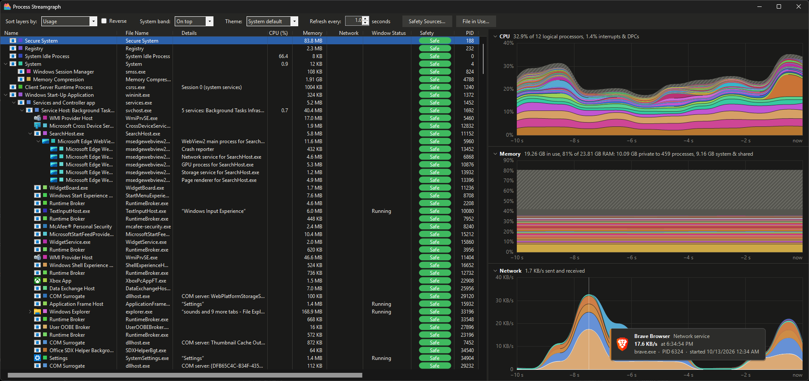

# Process Streamgraph

A Windows process monitor that draws CPU, memory, GPU and network use as stacked streamgraphs, one band per process, next to a process tree.



## Features

- **Streamgraphs** for CPU, memory, GPU, GPU memory and network, covering up to 5 minutes of history. Hover over a band for details; click it to select the process; right-click it for the process menu.
- **Task Manager–consistent totals.** A striped band shows what no process is charged for (interrupts and DPCs for CPU, kernel and shared memory for memory), so the totals match Task Manager.
- **Process tree** with details for each process: services hosted, window titles, working folders, and the role of browser helper processes.
- **Safety ratings** for programs and the network hosts they talk to, from configurable online sources.
- **Connections** shows the remote hosts each process exchanges data with.
- **File in Use** finds the processes holding a file or folder open when Windows won't delete it.
- Light and dark themes, a time span slider, resizable and collapsible graphs.

## Requirements

- Windows 10 or 11 with .NET Framework 4.7.2 or later.
- Per-process network traffic needs administrator rights. Without them, the Connections window lists open TCP connections only.

## Building

```
dotnet build -c Release
```

The program is written to `bin/Release/net472/ProcessStreamgraph.exe`.
